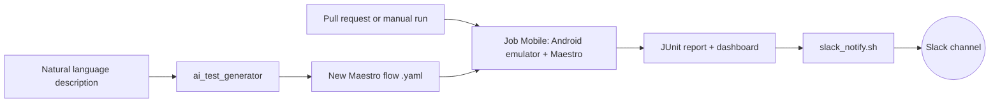

# QA Automation Portfolio — Maestro + CI/CD + AI-Assisted Testing

A portfolio repository demonstrating an **AI-first** QA automation stack: mobile testing with [Maestro](https://maestro.mobile.dev) on an Android emulator in GitHub Actions, Slack reporting, and an AI-powered utility to accelerate test case generation.

> This project is built as a learning/portfolio artifact, not production software. Where features are still experimental (e.g., Maestro web support), that's explicitly flagged — I prefer transparency about real tool state over simulating what doesn't work.

## AI test generator — the highlight of this repo

`scripts/ai_test_generator/` turns a plain-language scenario into a runnable Maestro flow, using the Claude API:

```bash
pip install -r scripts/ai_test_generator/requirements.txt
export ANTHROPIC_API_KEY=sk-ant-...

python scripts/ai_test_generator/generate_flow.py \
  --app-id org.wikipedia \
  --scenario "Open app, navigate to settings, toggle dark mode" \
  --output maestro/mobile/flows/11_dark_mode.yaml
```

**Current status, honestly:** the generated flow is a starting point, not a drop-in test — I always review and run it locally before committing (see the `git commit -m "... (AI-generated)"` step below). The generator rejects answers it cannot use (invalid YAML, wrong `appId`, cut-off output), logs tokens and cost per call, and keeps an untouched copy of each flow. `scripts/ai_test_generator/measure_edits.py` then diffs that copy against the flow that finally passed, so the share of each flow the model wrote unchanged is measured instead of claimed. The generator has its own pytest suite in CI. Results will be published here once there are enough generated flows to report.

## Why this project exists

Built to address a **QA Automation Engineer** job description asking for:

| Job Requirement | Where in this repo | Status |
|---|---|---|
| Manual, functional, regression, and exploratory tests | `docs/manual-test-cases.md` | ✅ |
| Automated mobile and web test suites | `maestro/mobile`, `maestro/web` | ✅Mobile (10/10 passing)  / ⚠️ Web (beta) |
| CI/CD integration (GitHub Actions) on every PR and on demand | `.github/workflows/` | ✅ |
| Automated Slack reporting | `notifications/slack_notify.sh` | ✅ Configured |
| LLM-assisted intelligent test generation | `scripts/ai_test_generator/` | ✅ Tested |
| Resilient flows | `maestro/mobile/subflows/` | ✅ Pop-ups closed by id in shared subflows, waits on animations instead of fixed sleeps |
| Flaky-test root-causing | `docs/testing-strategy.md` | ✅ Each CI failure traced to a cause before it was fixed |
| SDLC / Agile / defect lifecycle | `docs/architecture.md` | ✅ |

## Architecture



## Project structure

```
maestro/
  mobile/flows/     -> Android Wikipedia app flows (open source, public)
  mobile/subflows/  -> Shared steps: onboarding, pop-ups, back to the tab bar
  web/flows/        -> the-internet.herokuapp.com flows (QA practice site)
scripts/
  ai_test_generator/ -> Generates Maestro flows from text descriptions (Anthropic API)
notifications/
  slack_notify.sh    -> Posts run summary to Slack via webhook
.github/workflows/
  mobile-tests.yml   -> Runs Android emulator + Maestro on PRs and on demand
  web-tests.yml      -> Maestro web tests, disabled (beta support, see below)
docs/
  testing-strategy.md      -> QA strategy, resilience patterns, CI failures and their root causes
  dashboard.md             -> Test analytics dashboard guide
  architecture.md
  manual-test-cases.md
```

## App under test (mobile)

**Wikipedia for Android** (`org.wikipedia`): open source, publicly available. It's also used in official Maestro tutorials, making it easy for anyone to reproduce tests without credentials or private apps.

## Scope: Android + Web (iOS intentionally excluded)

Maestro supports iOS identically to Android (same flow syntax). I deliberately excluded iOS from this portfolio due to time prioritization: setting up iOS (Xcode + simulator) wouldn't add relevant learning beyond what Android demonstrates. That time was invested in CI/CD depth, automated reporting, and AI-assisted test generation — the kind of trade-offs QA engineers make under real deadlines.

## App under test (web)

`https://the-internet.herokuapp.com` — a classic QA practice site with intentionally difficult elements (drag-and-drop, iframes, dynamic content), good for demonstrating depth beyond happy paths.

## Running locally

### Mobile and web tests

```bash
# Install Maestro
curl -Ls "https://get.maestro.mobile.dev" | bash

# Run mobile tests
maestro test maestro/mobile/flows/

# Run web tests (requires Chrome/browser)
maestro test maestro/web/flows/
```

### AI-powered test generator

```bash
# Setup
pip install -r scripts/ai_test_generator/requirements.txt
export ANTHROPIC_API_KEY=sk-ant-...

# Generate a new test flow from natural language description
python scripts/ai_test_generator/generate_flow.py \
  --app-id org.wikipedia \
  --scenario "Open app, navigate to settings, toggle dark mode" \
  --output maestro/mobile/flows/11_dark_mode.yaml

# Review the generated flow, run locally, then commit
maestro test maestro/mobile/flows/11_dark_mode.yaml
git add maestro/mobile/flows/11_dark_mode.yaml scripts/ai_test_generator/generated scripts/ai_test_generator/generations.jsonl
git commit -m "Add dark mode toggle test (AI-generated)"

# How much of each passing flow did the model write unchanged?
python scripts/ai_test_generator/measure_edits.py --flows maestro/mobile/flows
```

## CI/CD Status

- **Mobile Tests**: ✅ **Passing** (10 flows) — [see real runs](https://github.com/gustavaom7/maestro-mobile-ai-qa/actions/workflows/mobile-tests.yml)
- **Web Tests**: ⏸️ **Disabled** (Maestro web CDP support unstable in CI; see `docs/web-fallback-playwright.md`)
- **Slack Notifications**: ✅ **Active**
- **Runs on**: every pull request, or on demand from the Actions tab (mobile only)

## Design decisions and trade-offs

### Android-only (iOS not included)

iOS exclusion was a deliberate prioritization decision. Maestro supports iOS with identical syntax, but setting up the environment (Xcode + simulator) wouldn't add relevant technical learning beyond Android. Time was prioritized for CI/CD depth, automated notifications, and AI-assisted generation — real trade-offs QA engineers make constantly.

### Web: Maestro beta support vs Playwright

Maestro web support is still beta. Web flows use current syntax (`url:`) but may need adjustments if Maestro versions diverge. A Playwright fallback is documented in `docs/web-fallback-playwright.md`. This exemplifies a real QA trade-off: adopt newer tools with more uncertainty, or stick with mature solutions.

## Test Resilience

The flows are written to survive the app's pop-ups and timing without hiding real failures:

- **Pop-ups closed by id in shared subflows** (`maestro/mobile/subflows/`): onboarding, the search-widget promo, the "Wikipedia games" dialog and the donate modal are closed by their button ids, with `optional: true` because they don't always appear. No blind coordinate taps.
- **Wait on the UI, not the clock**: `waitForAnimationToEnd` and assertions on the next screen instead of fixed sleeps.
- **Bounded recovery**: going back to the tab bar presses back until the tab bar is visible, capped at 5, instead of a fixed number of backs.

This is ordinary defensive flow design, not self-healing: when the app changes a selector, the flow fails and someone fixes it.

**Result:** all 10 flows pass in CI (about 21 min of flows on an Android emulator, about 24 min for the whole job) — see the [actual run history](https://github.com/gustavaom7/maestro-mobile-ai-qa/actions/workflows/mobile-tests.yml) rather than taking this on faith (root-cause detail in `docs/testing-strategy.md`)

See `docs/testing-strategy.md` for:
- Each CI failure, its root cause and the fix
- The CI environment (emulator, API level, app build)

## Test Analytics Dashboard

An interactive HTML dashboard automatically generated after each test run, showing:

- **Pass rate trends** over last 30 runs
- **Execution time trends** (detects performance regressions)
- **Per-flow health metrics** (pass rate, retries, failures)
- **Flakiness analysis** (retry distribution by flow)

**Access:**
- CI: Download artifact `test-dashboard` from workflow run
- Local: `python3 scripts/generate_dashboard.py && open reports/test-dashboard.html`

See `docs/dashboard.md` for full guide on interpreting metrics and troubleshooting.

## Next steps (if evolving further)

- LLM-suggested selector fixes: send a broken selector and the current UI tree to an LLM, propose a patch for human review
- Failure history per flow to order and prioritize runs
- Measure how much a generated flow is edited before it passes (the AI generator's open to-do)
- Screenshot comparison: detect visual regressions (not just functional)
- Load testing: test app under network constraints (3G, packet loss)
- Jira/Linear integration: auto-create tickets for recurring failures
